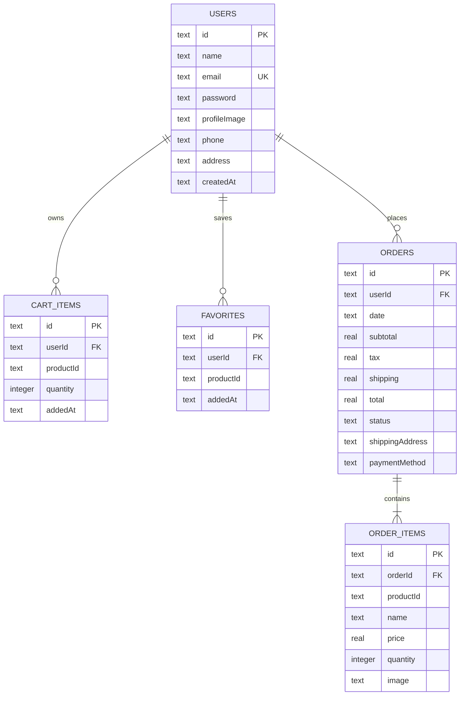

# Chip Happens database schema

Chip Happens now uses Supabase Auth and Supabase PostgreSQL for customer profiles, carts, and favorites. The older SQLite/localStorage schema is retained below as a legacy reference for payment/order code that has not yet been migrated.

## Legacy schema (SQLite and web localStorage)

### `users`

| Column | Type | Rules |
|---|---|---|
| `id` | `TEXT` | Primary key |
| `name` | `TEXT` | Required |
| `email` | `TEXT` | Required, unique, normalized to lowercase |
| `password` | `TEXT` | Required; SHA-256 hex for newly created/migrated accounts |
| `profileImage` | `TEXT` | Optional |
| `phone` | `TEXT` | Optional |
| `address` | `TEXT` | Optional |
| `createdAt` | `TEXT` | Required ISO-8601 timestamp |

### `cart_items`

| Column | Type | Rules |
|---|---|---|
| `id` | `TEXT` | Primary key |
| `userId` | `TEXT` | Required; foreign key to `users.id`, cascade delete |
| `productId` | `TEXT` | Required; references the static product catalog in application code |
| `quantity` | `INTEGER` | Required, greater than zero |
| `addedAt` | `TEXT` | Required ISO-8601 timestamp |

Indexes: `userId`, `productId`.

### `favorites`

| Column | Type | Rules |
|---|---|---|
| `id` | `TEXT` | Primary key |
| `userId` | `TEXT` | Required; foreign key to `users.id`, cascade delete |
| `productId` | `TEXT` | Required; references the static product catalog |
| `addedAt` | `TEXT` | Required ISO-8601 timestamp |

Unique constraint: (`userId`, `productId`). Indexes: `userId`, `productId`.

### `orders`

| Column | Type | Rules |
|---|---|---|
| `id` | `TEXT` | Primary key |
| `userId` | `TEXT` | Required; foreign key to `users.id`, cascade delete |
| `date` | `TEXT` | Required ISO-8601 timestamp |
| `subtotal` | `REAL` | Required, zero or greater |
| `tax` | `REAL` | Required, zero or greater |
| `shipping` | `REAL` | Required, zero or greater |
| `total` | `REAL` | Required, zero or greater |
| `status` | `TEXT` | `pending`, `processing`, `shipped`, `delivered`, or `cancelled` |
| `shippingAddress` | `TEXT` | Required serialized JSON `ShippingInfo` object |
| `paymentMethod` | `TEXT` | Required |

`ShippingInfo` contains `firstName`, `lastName`, `email`, `phone`, `address`, `city`, `state`, `zipCode`, and `country`. Indexes: `userId`, `status`.

### `order_items`

| Column | Type | Rules |
|---|---|---|
| `id` | `TEXT` | Primary key |
| `orderId` | `TEXT` | Required; foreign key to `orders.id`, cascade delete |
| `productId` | `TEXT` | Required; product snapshot reference |
| `name` | `TEXT` | Required product-name snapshot |
| `price` | `REAL` | Required, zero or greater |
| `quantity` | `INTEGER` | Required, greater than zero |
| `image` | `TEXT` | Required product-image snapshot |

Index: `orderId`.

On web, these tables are represented by JSON arrays under `cookie_app_users`, `cookie_app_cart_items`, `cookie_app_favorites`, `cookie_app_orders`, and `cookie_app_order_items`. The active session is stored separately under `cookie_app_current_user_v2`. The obsolete `app_current_user` key is removed on startup so sessions created by the earlier unvalidated implementation cannot bypass the login landing page.

## Supabase/PostgreSQL schema

The complete executable schema, including all constraints, indexes, row-level-security policies, the new-user trigger, and the 24-product seed catalog, is in [`supabase/migrations/20240101000000_initial_schema.sql`](supabase/migrations/20240101000000_initial_schema.sql). Existing projects must also apply [`supabase/migrations/20261011000000_require_authentication.sql`](supabase/migrations/20261011000000_require_authentication.sql) to remove guest order access and restrict profiles to their owners.

Its relationships are:

- `auth.users` 1:1 `public.profiles`
- `auth.users` 1:N `public.cart_items`
- `auth.users` 1:N `public.favorites`
- `auth.users` 1:N `public.orders` (nullable to allow guest orders)
- `public.products` 1:N `public.cart_items`, `public.favorites`, and `public.order_items`
- `public.orders` 1:N `public.order_items`

The public tables are `profiles`, `products`, `cart_items`, `favorites`, `orders`, and `order_items`. The migration is the source of truth for their PostgreSQL column types and security policies.
